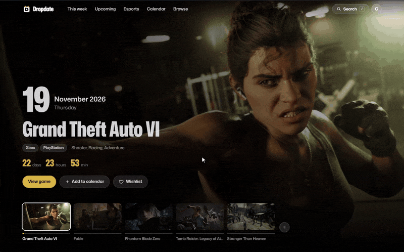
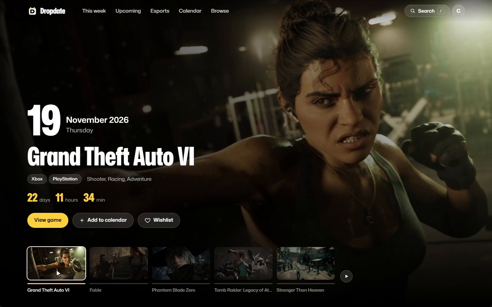
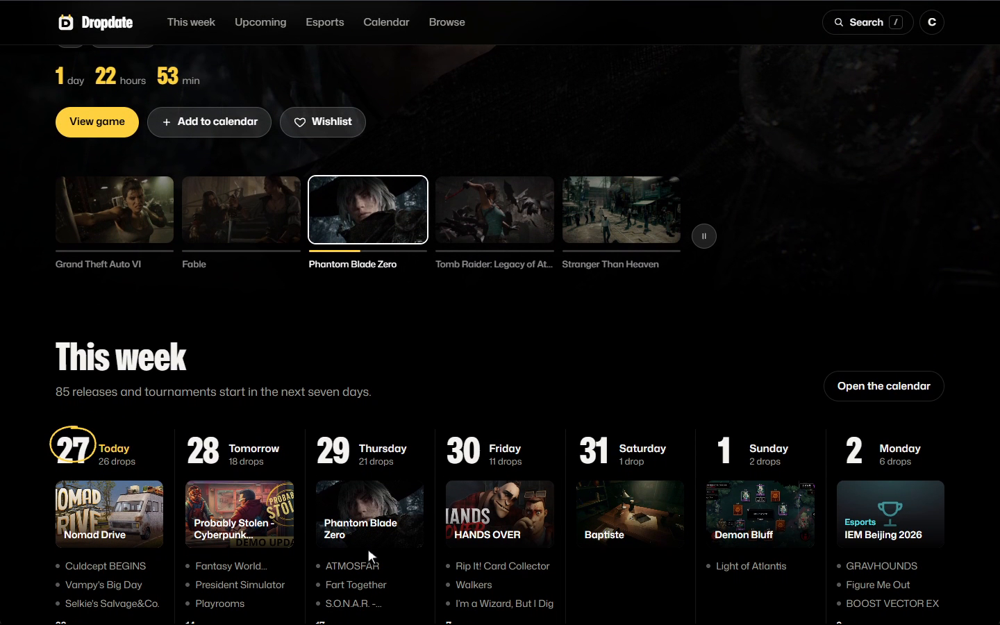
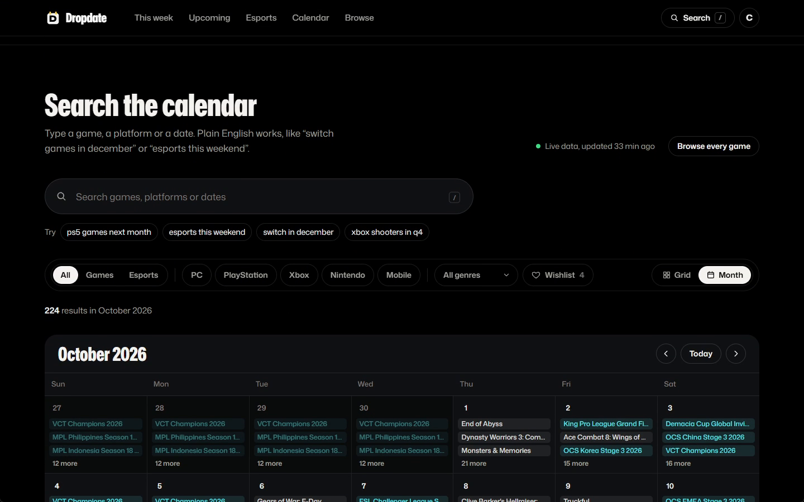
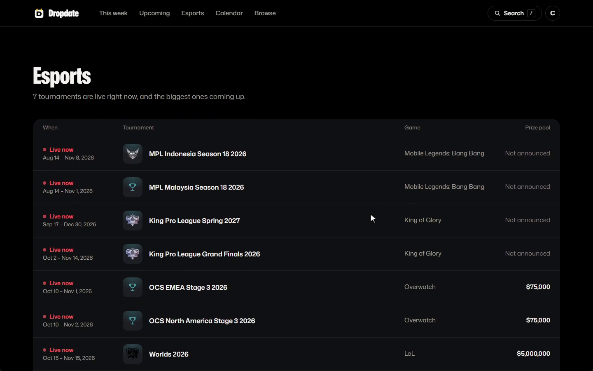

<h1 align="center">Dropdate</h1>

<p align="center">Game release calendar</p>

<p align="center"><b><a href="https://dropdate.net">dropdate.net</a></b> · <a href="https://www.gimzdev.com/work/dropdate?utm_source=github">Case study</a></p>

<p align="center"></p>

Dropdate puts game releases and esports tournaments in one calendar, refreshed every hour. Search it in plain
English, keep a wishlist, and add any view to Google, Apple or Outlook calendars, where it follows a game when its
date moves.

## Features

- **Feeds.** This week, most anticipated and just released, grouped by day.
- **Games.** Dates, artwork and critic scores, with filters for platform and genre.
- **Search.** Plain English ("ps5 games next month", "esports this weekend"), typos forgiven, and a title's initials work (gta, re4).
- **Esports.** Live and upcoming tournaments with dates and prize pools.
- **Accounts.** A wishlist and the games you played, each markable as completed. Sign-in has no password: a six-digit code by email.
- **Emails.** A message on a wishlisted game's release day and when its date moves, only for the games you ask for. One link stops them all.
- **Calendar feeds.** Any view or your wishlist in Google, Apple or Outlook calendars, updated when a date moves.

<p align="center">   </p>

## Built with

Next.js (App Router), React, TypeScript, Tailwind CSS, PostgreSQL through `pg` and Better Auth.

<details>
<summary>Implementation notes</summary>

- **Sources.** IGDB is the catalog. Steam adds upcoming PC games, critic scores, trailers and long descriptions. PandaScore adds esports. Each is cached and fails on its own: whatever answers is shown, and a source without a key is skipped.
- **Search.** Plain-English filters come first (a platform, a date such as next month, this weekend or Q4, releases or tournaments), then text that forgives typos: an edit distance where two swapped letters count as one edit. The same code runs in the browser and behind the site's own API.
- **Calendar feeds.** The `.ics` export follows RFC 5545, long lines folded at 75 bytes, and every deploy fetches the feed with the user agents of Google Calendar, Apple Calendar and Outlook before it counts as live.
- **Accounts.** Of what a sign-in could tell the site, only the email is kept. Rate-limit keys are hashed, so no table holds a readable IP address or email, and an account unused for 24 months is deleted.

</details>

## Run it

```bash
git clone https://github.com/gimzdev/dropdate.git
cd dropdate
npm ci
npm run dev        # http://localhost:3000
```

Node.js 20.9 or newer. Keys go in `.env.local`: `TWITCH_CLIENT_ID` and `TWITCH_CLIENT_SECRET` for IGDB, the game
database, and `PANDASCORE_TOKEN` for esports. Steam needs none. Accounts stay off until the site has a PostgreSQL
database: `DATABASE_URL`, `NEXT_PUBLIC_ACCOUNTS=1` and, in production, `BETTER_AUTH_SECRET`. `npm run migrate`
applies `db/*.sql`.

This repository is written by one script, which also installs and deploys the app, and is pushed after each deploy.

## Licence and credits

Public domain under [CC0 1.0](LICENSE). Game data and artwork come from [IGDB](https://www.igdb.com) and
[Steam](https://store.steampowered.com), tournaments from [PandaScore](https://pandascore.co).

<sub>Names and images belong to their owners.</sub>

<p align="center"><sub><a href="https://www.gimzdev.com/?utm_source=github">Gimz</a> · <a href="https://github.com/gimzdev/grimoire">Grimoire</a> · <a href="https://github.com/gimzdev/metaforge">MetaForge</a> · <a href="https://github.com/gimzdev/patchlab">Patchlab</a> · <a href="https://github.com/gimzdev/mosaik">Mosaïk</a></sub></p>
