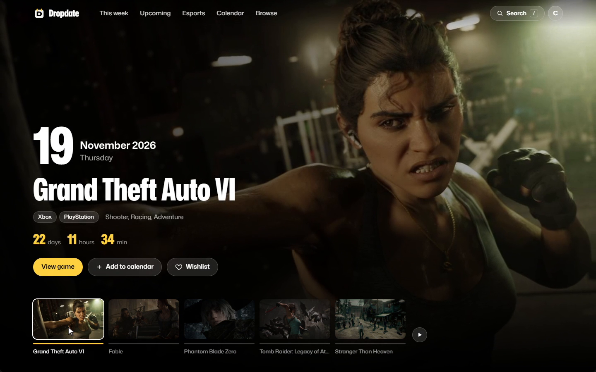
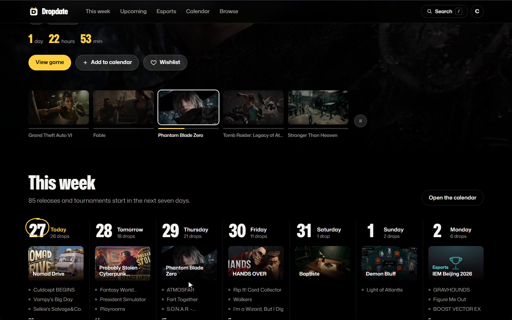
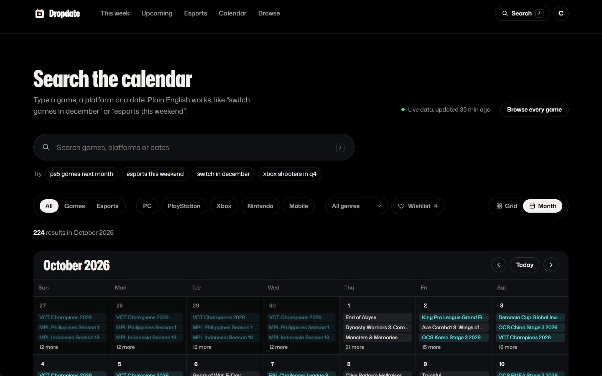
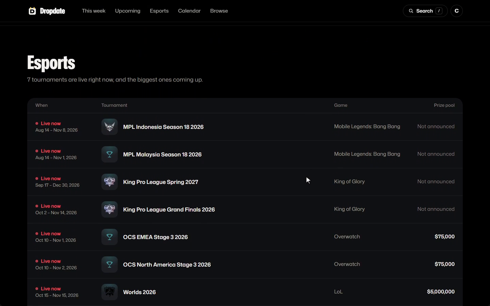

<div align="center">

# Dropdate

Game releases and esports tournaments in one calendar, with a free API.

[dropdate.net](https://dropdate.net) · [API](https://dropdate.net/docs) · Next.js · TypeScript · PostgreSQL

</div>

<table>
<tr>
<td align="center" width="50%"><br><sub>Home</sub></td>
<td align="center" width="50%"><br><sub>This week</sub></td>
</tr>
<tr>
<td align="center" width="50%"><br><sub>Calendar</sub></td>
<td align="center" width="50%"><br><sub>Esports</sub></td>
</tr>
</table>

## What's in it

- **This week**, **most anticipated** and **just released**: releases and tournaments, grouped by day
- **Every game**: release dates, artwork and critic scores, searched in plain English and filtered by platform and genre
- **Esports**: live and upcoming tournaments, with dates and prize pools
- **Accounts**: a wishlist and the games you played, each markable as completed
- **Calendar sync**: any view in Google Calendar, Apple Calendar or Outlook, following dates as they move
- **A free API**: JSON or an iCalendar feed, no key needed ([docs](https://dropdate.net/docs))

```bash
GET /api/events?q=ps5%20releases%20next%20month&limit=10
GET /api/calendar.ics?type=release&q=xbox
```

## Run it

```bash
npm install
npm run dev
```

Needs Node.js 20.9 or newer. Add the keys you have to `.env.local`: `TWITCH_CLIENT_ID` and
`TWITCH_CLIENT_SECRET` (IGDB), `PANDASCORE_TOKEN` (esports), `DATABASE_URL` (accounts). A source
without a key is skipped; Steam needs none.

<sub>Game data from IGDB and Steam, esports from PandaScore. Names and images belong to their owners.</sub>
